# Personal

A private Flutter app that pulls together personal data from several sources—health, spending, location, gaming, and calendar—and runs unified **analysis** workflows. You pick which sources to include, configure how the AI should reason about your life, and get structured insights plus weekly checklists for the month ahead, then score your progress against those checklists the following month.

**Version:** 2.2.1  
**Platform:** Android (primary, `minSdk 26`); an `ios/` runner is checked in but experimental (Health Connect is Android-only)

## What it does

Personal acts as a private **data hub**. Each feature module loads and summarizes one domain. The main shell has three tabs—**Home**, **Checklist**, and **Review**—plus a slide-out drawer for settings. A first-run **onboarding** walkthrough guides setup (data folder, personal profile, AI key); it can be replayed from Settings. Appearance follows the system or can be forced **Light** / **Dark**.

From **Home**, open any data module or tap the **Analyze** button to choose between:

- **Monthly insights** — analyze current-month data and generate next-month checklists
- **Progress review** — compare checklist targets against current-month data and score each domain

Home also has an **Export data** action (raw or AI-curated markdown) and a setup checklist card that tracks what is still missing.

Analysis is scoped to the **current calendar month through today**. Parsed action items become **weekly checklists** for the following month, with optional local notifications when the month ends or a week ends with unchecked items.

## Screenshots

Walk through the app in the same order you would use it: open the hub, connect data, run analysis, review insights, track checklists, and score progress.

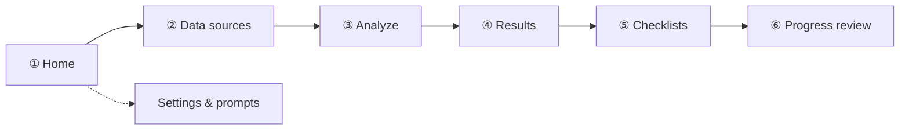

---

### ① Home — open the data hub

Start on the home grid. Each tile opens a data module. The bottom nav switches between **Home**, **Checklist**, and **Review**. Tap **Analyze** (sparkle button) when you are ready.

<table cellpadding="28" cellspacing="20" border="0">
  <tr>
    <td align="center" width="50%" valign="top" style="padding: 16px 24px;">
      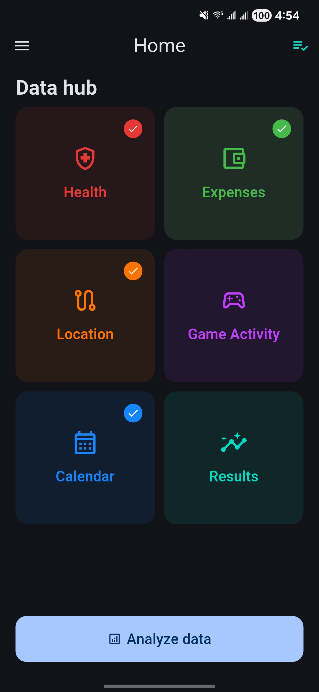<br><br>
      <sub><b>Home</b> — data hub & bottom nav</sub>
    </td>
    <td align="center" width="50%" valign="top" style="padding: 16px 24px;">
      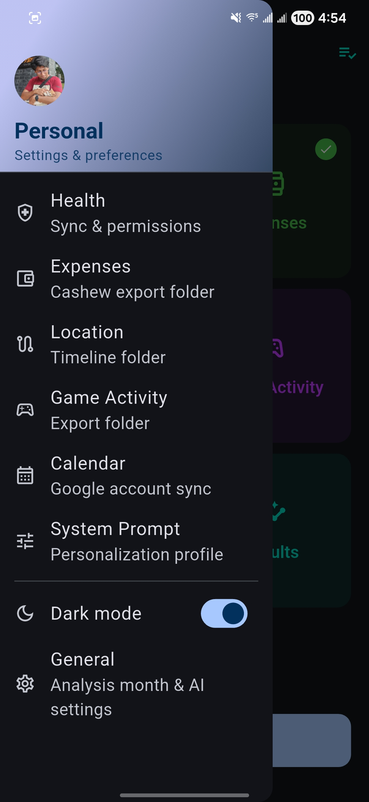<br><br>
      <sub><b>Drawer</b> — settings & shortcuts</sub>
    </td>
  </tr>
</table>

---

### ② Data sources — connect each module

Open a tile to load that month’s data. Health Connect, Cashew exports, location files, game CSV, and Google Calendar each feed the same analysis pipeline.

<table cellpadding="28" cellspacing="20" border="0">
  <tr>
    <td align="center" width="50%" valign="top" style="padding: 16px 24px;">
      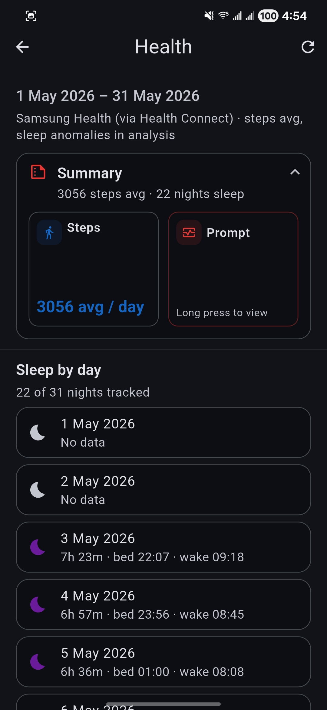<br><br>
      <sub><b>Health</b> — steps & sleep</sub>
    </td>
    <td align="center" width="50%" valign="top" style="padding: 16px 24px;">
      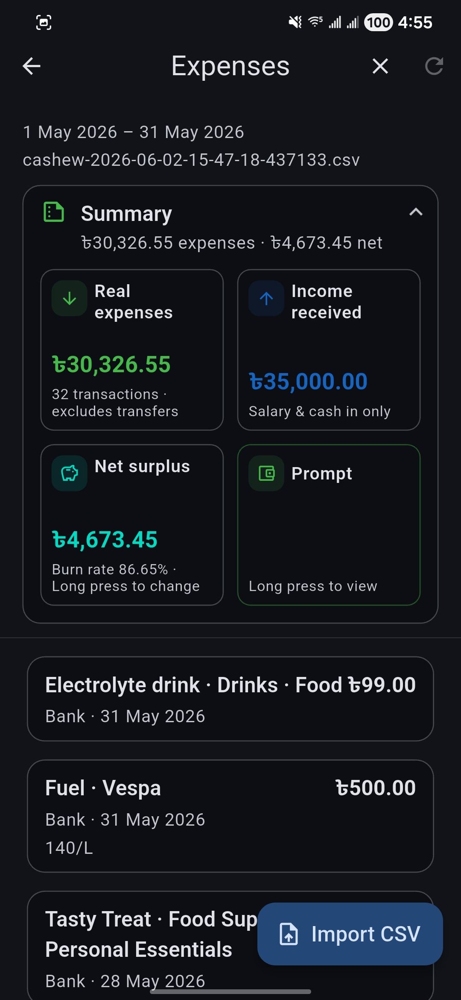<br><br>
      <sub><b>Expenses</b> — Cashew CSV</sub>
    </td>
  </tr>
  <tr>
    <td align="center" colspan="2" height="12"></td>
  </tr>
  <tr>
    <td align="center" width="50%" valign="top" style="padding: 16px 24px;">
      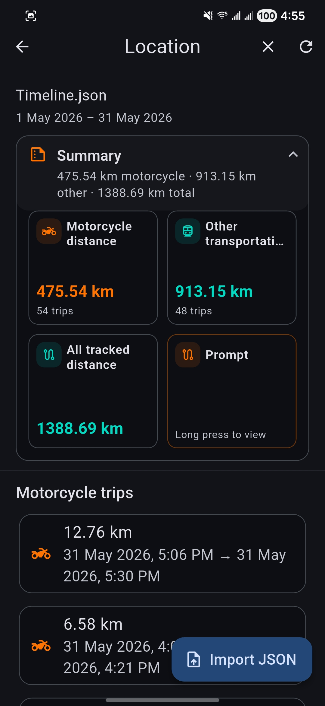<br><br>
      <sub><b>Location</b> — timeline export</sub>
    </td>
    <td align="center" width="50%" valign="top" style="padding: 16px 24px;">
      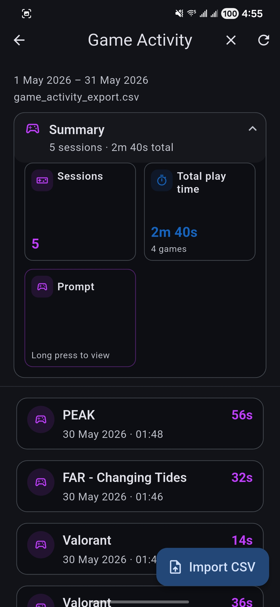<br><br>
      <sub><b>Game activity</b> — session log</sub>
    </td>
  </tr>
  <tr>
    <td align="center" colspan="2" height="12"></td>
  </tr>
  <tr>
    <td align="center" colspan="2" valign="top" style="padding: 16px 24px;">
      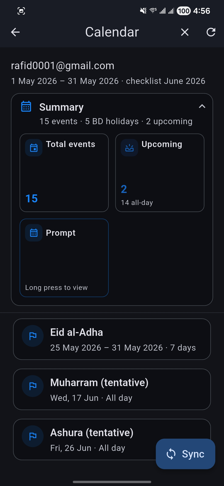<br><br>
      <sub><b>Calendar</b> — Google Calendar sync</sub>
    </td>
  </tr>
</table>

---

### ③ Analyze — pick a run type and sources

Tap **Analyze** on Home to choose **Monthly insights** or **Progress review**, then confirm which data sources to include for the current month.

<table cellpadding="28" cellspacing="20" border="0">
  <tr>
    <td align="center" width="50%" valign="top" style="padding: 16px 24px;">
      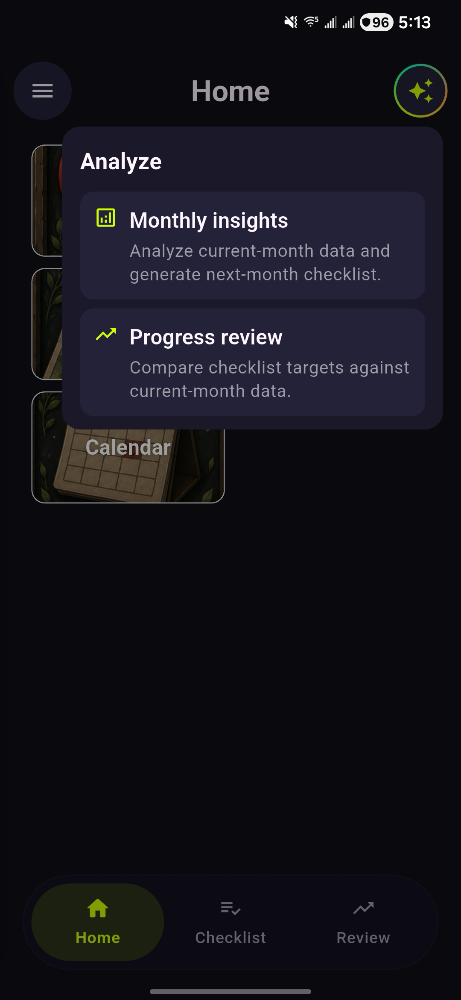<br><br>
      <sub><b>Analyze</b> — monthly insights or progress review</sub>
    </td>
    <td align="center" width="50%" valign="top" style="padding: 16px 24px;">
      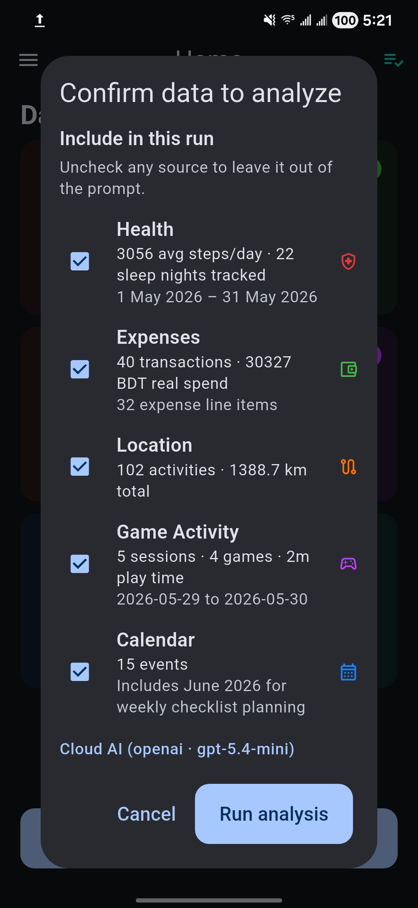<br><br>
      <sub><b>Confirm</b> — select data sources</sub>
    </td>
  </tr>
</table>

---

### ④ Results — read monthly insights

Saved monthly-insight runs appear in **Results** (opened from the Review tab). Tap a card to read the full report and parsed action items.

<table cellpadding="28" cellspacing="20" border="0">
  <tr>
    <td align="center" width="50%" valign="top" style="padding: 16px 24px;">
      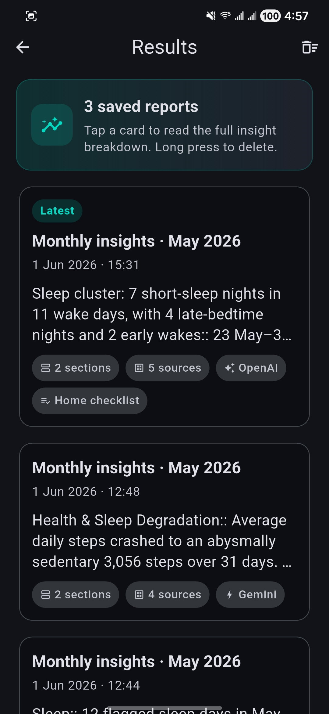<br><br>
      <sub><b>Results</b> — saved runs</sub>
    </td>
    <td align="center" width="50%" valign="top" style="padding: 16px 24px;">
      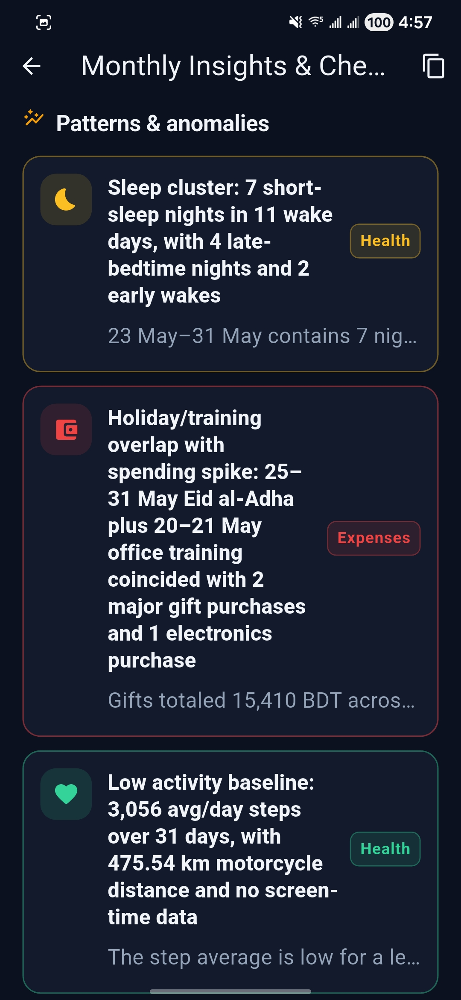<br><br>
      <sub><b>Results</b> — insight detail</sub>
    </td>
  </tr>
</table>

---

### ⑤ Checklists — plan the month ahead

Action items from a monthly-insights run become weekly checklists for the following month. Switch weeks from the horizontal picker.

<table cellpadding="28" cellspacing="20" border="0">
  <tr>
    <td align="center" colspan="2" valign="top" style="padding: 20px 24px;">
      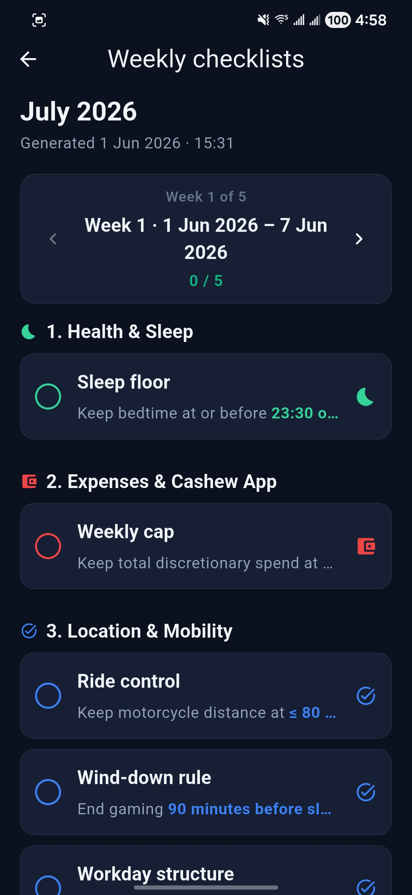<br><br>
      <sub><b>Checklist</b> — weekly segments & themes</sub>
    </td>
  </tr>
</table>

---

### ⑥ Progress review — score checklist targets

The **Review** tab shows how current-month data compares to checklist targets, with an overall score and per-domain breakdown.

<table cellpadding="28" cellspacing="20" border="0">
  <tr>
    <td align="center" colspan="2" valign="top" style="padding: 20px 24px;">
      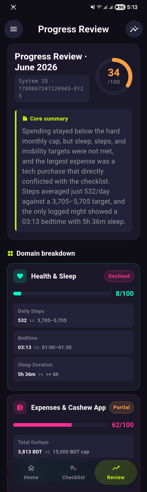<br><br>
      <sub><b>Review</b> — targets vs actuals</sub>
    </td>
  </tr>
</table>

---

### Settings — tune prompts & AI

Configure assistant identity, analysis month, reminders, and API settings from the drawer (**Personal information**, **AI provider**, **Storage & backup**, **All settings**) or the **System Prompt** screen.

<table cellpadding="28" cellspacing="20" border="0">
  <tr>
    <td align="center" width="50%" valign="top" style="padding: 16px 24px;">
      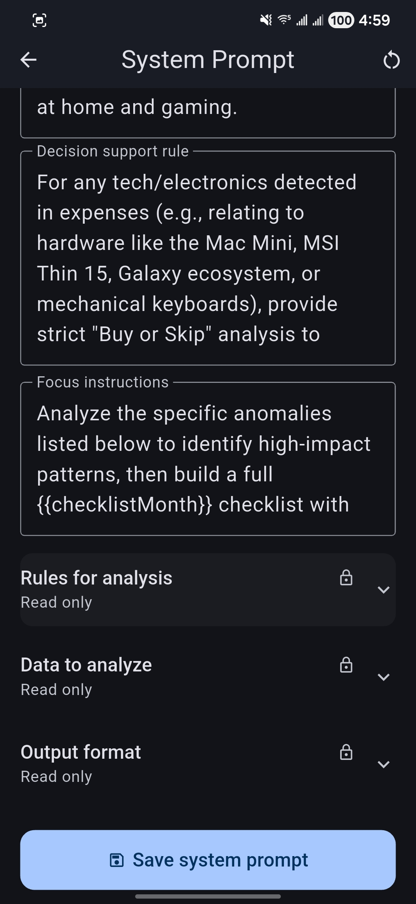<br><br>
      <sub><b>System Prompt</b> — AI & analysis tone</sub>
    </td>
    <td align="center" width="50%" valign="top" style="padding: 16px 24px;">
      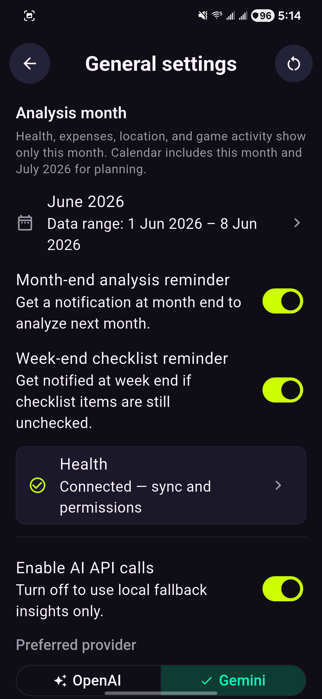<br><br>
      <sub><b>General</b> — month, reminders & AI provider</sub>
    </td>
  </tr>
</table>

## Features

| Module | Data source | Role in analysis |
|--------|-------------|------------------|
| **Health** | Health Connect: sleep (with stages) plus opt-in vitals (steps, heart rate, workouts, weight) | Monthly averages, patterns, sleep anomaly filtering |
| **Expenses** | Cashew CSV (data folder or Google Drive `Cashew/outbox.csv`) | Totals, categories, real vs. excluded transactions, money flow (savings, debts, typical month, income sources, repeat places), selectable spending categories |
| **Location** | User-selected timeline export files | Activity patterns, work-arrival stats |
| **Game activity** | CSV export (e.g. gaming tracker) | Session summaries |
| **Calendar** | Google Calendar (OAuth) | Events merged into the snapshot; future-event coverage check. Dated predictions can be written back as all-day events; **Fix calendar events** removes duplicates and re-adds current ones |
| **Dashboard** | All of the above | Reorderable analysis cards, stable-month detection, charts, and a **Predictions** section |
| **Bike odometer** | Monthly manual readings (synced with the personal profile) | Sharpens the bike-service and oil-change predictions; optional monthly reminder |
| **Results** | Generated locally or via API | Saved monthly-insight runs, rich-text reports, actionable checklists |
| **Progress review** | Checklist targets + current-month data | Domain scores comparing targets to actuals, with verified numeric deltas |
| **Export** | Same data the analysis uses | Raw markdown export, optionally AI-curated, for sharing with another assistant (no AI call unless you choose curation) |

**Main shell tabs:** **Home** (data hub), **Checklist** (weekly segments), **Review** (progress scores; opens the Results list from the app bar).

Drawer screens: **System Prompt** (assistant instructions and personal profile), **General** (analysis month, Health Connect, AI provider, notifications, backup), and per-feature **settings** (folders, permissions, Google sign-in).

### Predictions (dashboard)

Forecasts are computed on-device from your data; the AI refinements are optional and need an AI provider. Each prediction can be switched on or off in the chooser (`forecasts/prediction_selection_service.dart`), and filtered by group on the dashboard.

| Group | Predictions |
|-------|-------------|
| **Money** | Next fuel, upcoming bills, budget run-out date, payday, bill watch (bills that rose or are late), holiday spending |
| **Body** | Weight trend, activity ahead, workout pace, resting heart rate, recovery |
| **Life** | Leave for work, checklist weak spots, best day to plan, bike service, oil change, bike odometer |

- **Fuel** (`forecasts/fuel/`): next refuel date and amount from past refuels and, when the location export overlaps enough of them, riding distance vs. typical tank range. The AI estimate weighs upcoming events and recent riding.
- **Recurring charges / Outlook** (`forecasts/outlook/`): bills and subscriptions expected again soon (cadence detection), month-end projection, and the date the budget runs out at a normal day's spending, each with an optional AI reading.
- **Life forecasts** (`forecasts/life/`): the body, commute and checklist forecasts. Each computes a baseline, then can hand the same raw data to an AI to redo the work; stale AI answers are detected when the data changes.
- **Reminders and calendar:** dated predictions can raise local notifications (lead time, time of day and weekly digest day are configurable, plus "leave now" commute nudges) and can be mirrored to your primary Google Calendar as tagged all-day events.

## Analysis pipeline

1. **Entry:** `analysis/analysis_launcher.dart` (gated on a data folder and a complete personal profile).
2. **Period:** `core/period/analysis_period.dart`—current calendar month through today; the checklist targets the following month, split into weeks.
3. **Snapshot:** `results/pipeline/analysis_snapshot_builder.dart` renders each selected source (`AnalysisSourceSelection` / `AnalysisDataSourceId` in `analysis/ui/analysis_data_preview.dart`; the confirm dialog can remember a selection for quick runs) through its `*_prompt_builder.dart`, plus derived metrics and goal tracking.
4. **Prompt:** `results/pipeline/analysis_prompt_renderer.dart` fills the user-editable template from `prompts/`.
5. **Generation:** `results/ai/ai_client.dart` calls OpenAI, Gemini, or Claude (streamed, with retries and cancellation). With API calls off, a local heuristic generator produces a structured fallback report.
6. **Repair & validation:** `results/pipeline/report_format_repair.dart` asks the model once to fix a missing checklist or week sections; the calendar future-event coverage check follows.
7. **Parse & persist:** `results/reports/insights_parser.dart` produces insights and checklist actions, saved via `analysis/analysis_reports_storage.dart` and `results/reports/results_service.dart`; monthly insights become the active checklist.
8. **Progress review & weekly verification** reuse the same machinery against a previous checklist; `ProgressReviewEvaluationEngine` enforces verified numbers.

## Architecture

```
lib/
  app/                  # App widget and route table
  core/                 # Cross-cutting infrastructure (no feature imports)
    storage/            #   prefs, generic JSON file cache, data-folder settings
    period/             #   analysis period math and the selected analysis month
    lifecycle/          #   app lifecycle host and service
    schedule/           #   weekday and time-range schedules
    app_info/           #   version / build info
    theme/              #   design tokens, ThemeData and Auto/Light/Dark mode
  features/             # One folder per domain; most use data/ + analysis/ + ui/
    analysis/           # Analysis kinds, period math, launcher, report storage; ui/ = confirm/progress dialogs
    auth/               # Google account / Firebase auth
    bike/               # Odometer readings and panel
    calendar/           # data/ (Google Calendar), analysis/ (prompt text), ui/
    dashboard/          # view/ (view-models, provider), ui/ (screen, charts), predictions/ (cards, list, chooser)
    expenses/           # data/ (Cashew CSV, Drive), analysis/ (insights, prompt text), ui/
    export/             # Raw / AI-curated markdown data export
    forecasts/          # prediction chooser state; life/ (life forecasts), fuel/, outlook/ (bills, budget, payday, recurring), reminders/ (notifications, calendar sync)
    game_activity/      # Gaming session CSV
    health/             # data/ (Health Connect), analysis/ (sleep, vitals prompts), ui/
    home/               # Home grid and summary providers
    location/           # data/ (Timeline export), analysis/ (places, work arrivals), ui/
    onboarding/         # First-run walkthrough
    progress_review/    # Checklist-vs-actual scoring dashboard
    prompts/            # System prompt & personal information
    results/            # ai/, pipeline/, local/, future_events/, checklist/, reports/, ui/
    settings/           # General settings & AI provider; widgets/ = notification and AI sections
  shared/               # Shared widgets and navigation helpers
  shell/                # Main shell, drawer, bottom nav
```

Each feature typically has a `*_service.dart` (load/parse), a summary/model type, and often a `*_prompt_builder.dart`. Large widget and logic files are split with `part` / `part of` so private members stay private. Adding a data source means registering it in `AnalysisDataSourceId` (`analysis/ui/analysis_data_preview.dart`) and adding branches in `buildDataSnapshot` / `renderPrompt`.

- **State:** [flutter_riverpod](https://pub.dev/packages/flutter_riverpod)
- **Health:** [health](https://pub.dev/packages/health) + Health Connect, [permission_handler](https://pub.dev/packages/permission_handler)
- **Files & parsing:** [file_picker](https://pub.dev/packages/file_picker), [dir_picker](https://pub.dev/packages/dir_picker), [uri_content](https://pub.dev/packages/uri_content), [csv](https://pub.dev/packages/csv)
- **Google:** [google_sign_in](https://pub.dev/packages/google_sign_in) + [googleapis](https://pub.dev/packages/googleapis) (Calendar, Drive)
- **Firebase:** Auth + Firestore, used only for sign-in and syncing the personal-info profile (`firestore.rules` scopes each user to `users/{uid}/personalInfo`)
- **Storage:** `shared_preferences`, JSON file cache, [flutter_secure_storage](https://pub.dev/packages/flutter_secure_storage) for API keys
- **Notifications:** [flutter_local_notifications](https://pub.dev/packages/flutter_local_notifications) (month-end analysis, week-end checklist, prediction, digest, commute and odometer reminders; exact alarms are used where allowed)

## Getting started

### Prerequisites

- Flutter SDK (Dart ^3.11.5)
- Android device or emulator (API 26+)
- Firebase config (not committed): copy `lib/firebase_options.dart.example` to `lib/firebase_options.dart`, or run `flutterfire configure --project=<project-id>` to generate `lib/firebase_options.dart` and `android/app/google-services.json`
- For health: **Health Connect** installed; grant sleep access (and steps, heart rate, workouts, weight if you enable vitals), e.g. via Samsung Health → Health Connect
- For expenses: **Cashew** export folder on device storage, or Google Drive access
- For calendar: Google account with Calendar API access (also used for Drive when loading Cashew from Drive)
- Optional: API keys for OpenAI, Gemini, or Claude in AI settings

### Run

```bash
flutter pub get
flutter run
```

### Checks

```bash
flutter analyze
dart format .
```

```bash
flutter test
```

Unit tests under `test/` cover the pure logic (period math, Cashew CSV and insights parsers, progress-review cap extraction, the data cache) plus a sync test that the offline insights generator produces output the parser can read, and architecture tests that keep `core/` and `shared/` free of feature imports. CI (`.github/workflows/ci.yml`) runs format, `flutter analyze` and `flutter test`; there is no UI or integration testing.

## Privacy & data

All personal data stays on the device unless you opt into a cloud AI provider (OpenAI, Gemini, or Claude) and enable **API calls**. Summaries are cached as JSON files in the app-support `data_cache/` directory (each feature owns its own cache shape); small settings use `shared_preferences`; API keys live in the Android Keystore via `flutter_secure_storage`. Android backup is disabled (`allowBackup="false"`) so cached data and keys never reach Google Drive; the app has its own backup file (`personal-backup.json`) that excludes device-specific folder URIs and caches. Only the personal-info profile syncs to Firestore.

## Screenshot checklist

| File | Screen |
|------|--------|
| `docs/screenshots/01-home.png` | Home / Data hub |
| `docs/screenshots/02-health.png` | Health summary |
| `docs/screenshots/03-expenses.png` | Expenses |
| `docs/screenshots/04-location.png` | Location |
| `docs/screenshots/05-game-activity.png` | Game activity |
| `docs/screenshots/06-calendar.png` | Calendar |
| `docs/screenshots/07-analysis-confirm.png` | Analysis source picker |
| `docs/screenshots/08-results.png` | Results list |
| `docs/screenshots/09-checklists.png` | Weekly checklists |
| `docs/screenshots/10-prompts.png` | System Prompt configuration |
| `docs/screenshots/11-drawer.png` | Navigation drawer |
| `docs/screenshots/12-results-details.png` | Results — insight detail |
| `docs/screenshots/13-analyze-options.png` | Analyze — run type picker |
| `docs/screenshots/14-progress-review.png` | Progress review dashboard |
| `docs/screenshots/15-general-settings.png` | General settings |

## License

Private project — not published to pub.dev (`publish_to: 'none'`).
